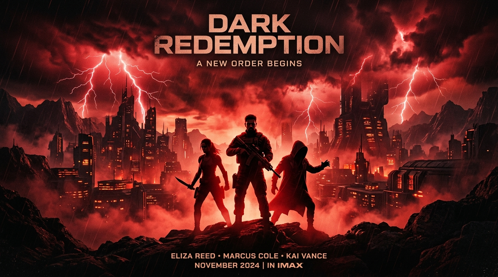

# 🎬 Prompt Studio &mdash; AI Visual & Video Showcase

> Dashboard showcase sinematik bertema streaming untuk memamerkan prompt AI **Text-to-Video** dan **Text-to-Image** berkualitas tinggi, dilengkapi pemutaran cuplikan video interaktif, fitur salin prompt sekali klik, unduh media asli, dan integrasi database cloud Supabase.



---

## ✨ Fitur Utama

- **Bento Dashboard Streaming UI**: Desain terinspirasi antarmuka streaming modern (*Stranger Things crimson style*, widget *Browse*, *Continue Watching*, *Top Pick Carousel*, dan kartu interaktif *Now Playing*).
- **Katalog Lengkap Prompt**: Dilengkapi pencarian *live search*, filter kategori *real-time* (*Sci-Fi, Cyberpunk, Cinematic, Fantasy*), serta filter tipe media (*Text-to-Video* & *Text-to-Image*).
- **Detail Lightbox Modal**: Melihat resolusi penuh, parameter aspek rasio, model AI (*Midjourney, Runway Gen-3, Kling, Sora, Flux*), dan negative prompt.
- **Salin Prompt & Unduh Media**: Tombol *Salin Prompt Lengkap* ke clipboard serta tombol *Download* file gambar/video asli.
- **Dual Mode Database**:
  - **Mode Data Lokal**: Berjalan 100% tanpa internet menggunakan file `js/data.js`.
  - **Mode Supabase Cloud**: Terhubung ke PostgreSQL Supabase untuk penyimpanan online tak terbatas.
- **Responsif Multi-Perangkat**: Optimal di layar desktop ultra-wide hingga smartphone dengan *Floating Bottom Navigation Bar*.

---

## 🚀 Menjalankan Secara Lokal

Website ini dibangun menggunakan **Vanilla Frontend murni** (HTML5, CSS3, JavaScript ES6) tanpa perlu proses *build* atau instalasi dependency yang rumit.

Cukup jalankan server lokal sederhana:

```bash
# Menggunakan Python
python -m http.server 8089

# Atau menggunakan Node.js (npx serve / live-server)
npx serve .
```

Lalu buka peramban di `http://localhost:8089`.

---

## 🗄️ Menghubungkan ke Supabase (Opsional)

1. Buat project baru di [supabase.com](https://supabase.com).
2. Buka menu **SQL Editor** -> **New Query**, lalu salin seluruh isi skrip [supabase_schema.sql](supabase_schema.sql) dan klik **Run**.
3. Buka website Prompt Studio, klik tombol **[• Data Lokal]** di pojok kanan atas atau ikon database di sidebar.
4. Masukkan **Project URL** dan **Anon Public Key** Anda, lalu klik **Simpan & Hubungkan Supabase**.

---

## 📦 Struktur Folder

```text
├── assets/
│   ├── images/         # Aset gambar visual AI
│   └── videos/         # Aset klip video AI
├── css/
│   └── style.css       # Desain sistem & styling Vanilla CSS
├── js/
│   ├── app.js          # Logika aplikasi, interaksi, filter & modal
│   ├── data.js         # Repositori data karya lokal fallback
│   └── supabase-config.js # Klien & koneksi database Supabase
├── index.html          # Halaman utama aplikasi
├── supabase_schema.sql # Skema tabel PostgreSQL & seed data
├── .gitignore
└── README.md
```

---

## 📄 Lisensi

Proyek ini dibuat untuk keperluan portofolio dan showcase publik karya AI.
